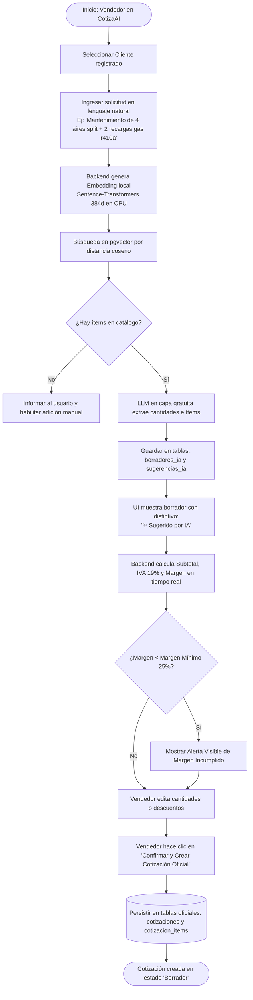
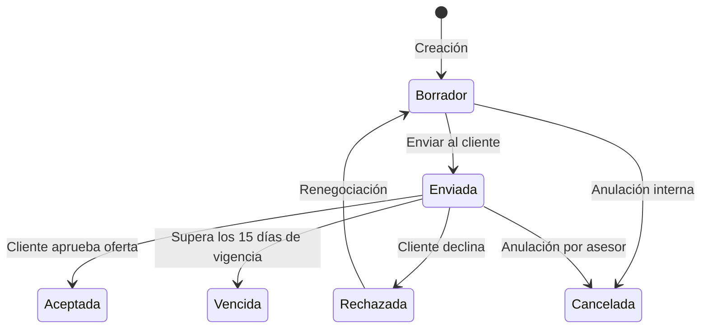
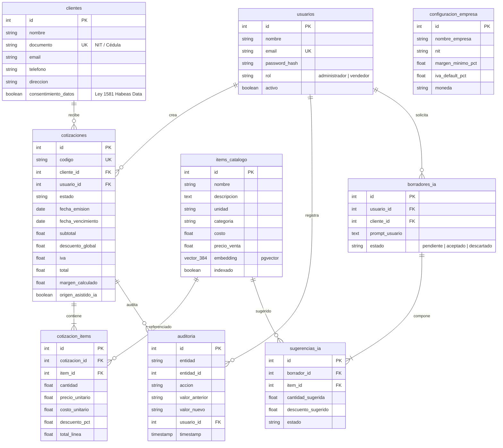

# CotizaAI — Avance 3
**Fecha de Entrega:** 12 de octubre de 2026  
**Proyecto de Ingeniería I** — Escuela de Transformación Digital  
**Universidad Tecnológica de Bolívar (UTB)**  
**Docente:** Prof. Aisner Marrugo  

**Integrantes del Equipo:**
* **Juan Diego Serpa Medina** — T00076352 (`juserpa@utb.edu.co`)
* **Kathy Luz Otero Pérez** — T00078184 (`kotero@utb.edu.co`)
* **Jesús David Julio Hawasly** — T00078265 (`jhawasly@utb.edu.co`)

---

## 1. Resumen Ejecutivo del Avance 3

En este tercer avance se materializa la experiencia de usuario y las bases estructurales de **CotizaAI**, una plataforma especializada en acelerar y blindar el proceso de cotización comercial para MiPymes de servicios (con foco en la Costa Caribe colombiana).

Este entregable incluye:
1. **Flujos de usuario principales:** mapeo detallado del flujo asistido por IA (Human-in-the-Loop), flujo manual, máquina de estados y control de rentabilidad.
2. **Prototipo navegable de alta fidelidad:** interfaz web interactiva y funcional ubicada en `frontend/index.html`, demostrando el comportamiento real de la aplicación, el asistente en lenguaje natural, las alertas de margen y la generación del PDF.
3. **Modelo inicial de datos:** esquema relacional normalizado con extensión `pgvector` en PostgreSQL 16 y tablas de guardrails para aislar las sugerencias de la IA.
4. **Decisiones de arquitectura:** justificación del monolito modular en FastAPI, embeddings locales en CPU ($0 costo recurrente) y desacoplamiento del LLM externo.
5. **Ajuste y depuración de alcance:** delimitación estricta de las 13 funcionalidades prioritarias del MVP frente a las funcionalidades diferidas al segundo semestre.

---

## 2. Principales Flujos de Usuario

### 2.1 Flujo Asistido con IA (El Flujo Diferencial — RF13, RF22, RF23)
Es el núcleo de valor de CotizaAI: convertir una solicitud informal de un cliente (ej. por WhatsApp o llamada) en una propuesta formal con precios reales de catálogo en menos de un minuto.

**Reglas clave de este flujo:**
* **Precios protegidos:** La IA nunca inventa ni altera los precios unitarios; se leen de la tabla `items_catalogo`.
* **Supervisión humana obligatoria:** Ningún registro definitivo se genera hasta que el usuario presione el botón de confirmación explícita (RF22).

---

### 2.2 Flujo de Creación Manual y Control de Rentabilidad (RF12, RF14, RF16)
Permite al vendedor armar propuestas tradicionales ítem por ítem con validaciones automáticas:

1. El usuario selecciona el cliente desde el autocompletado.
2. Agrega ítems del catálogo buscando por texto libre o categoría.
3. El sistema calcula en tiempo real:
   $$\text{Subtotal} = \sum (\text{Cantidad} \times \text{Precio Unitario})$$
   $$\text{Base Gravable} = \text{Subtotal} - \text{Descuento Global}$$
   $$\text{Total} = \text{Base Gravable} + (\text{Base Gravable} \times 0.19)$$
   $$\text{Margen \%} = \frac{\text{Base Gravable} - \text{Costo Total}}{\text{Base Gravable}} \times 100$$
4. Si el margen cae por debajo del 25.0% (mínimo de la empresa), la interfaz despliega una advertencia en color rojo/ámbar alertando la pérdida de rentabilidad antes de emitir la cotización.

---

### 2.3 Flujo de Máquina de Estados y Generación de PDF (RF17, RF18)
Regula el ciclo de vida de la cotización y garantiza trazabilidad mediante auditoría:

* **Descarga de PDF:** Disponible en cualquier momento, generando un documento membretado con datos de la empresa (ClimaCaribe S.A.S.), desglose impositivo y cláusulas legales de validez.

---

## 3. Prototipo Navegable y Experiencia de Usuario

El prototipo funcional se encuentra implementado en el directorio `frontend/index.html` y cuenta con las siguientes características:

1. **Dashboard Comercial:** KPIs de monto total cotizado, tasa de conversión comercial (68.4%), margen promedio (34.2%) y listado de cotizaciones recientes con buscador y acciones rápidas.
2. **Asistente de Cotización Asistida:**
   * Selector de clientes reales de prueba de Cartagena (Hotel Caribe Plaza, Restaurante La Cevichera, etc.).
   * Entrada de lenguaje natural con botones de ejemplos listos para probar con un clic.
   * Simulación de indexación semántica y generación de borrador temporal.
   * Visualización con badges distintivos **"✨ Sugerido por IA"**.
   * Medidor de margen dinámico con alerta en vivo de margen mínimo.
   * Botón de **"Confirmar y Crear Cotización Oficial"** para ilustrar la supervisión humana.
3. **Catálogo & Búsqueda Semántica:** Demostración de búsqueda por intención (ejemplo: buscar *"arreglo de frío"* y recuperar *"Mantenimiento Preventivo Aire Split"*).
4. **Modal de Vista Previa de PDF:** Renderizado fiel del documento formal listo para impresión o exportación.
5. **Selector de Rol:** Conmutador en el sidebar para visualizar las vistas como *Vendedor* o *Administrador*.

---

## 4. Modelo Inicial de Datos (PostgreSQL 16 + pgvector)

### 4.1 Diagrama Entidad-Relación

### 4.2 Decisiones de Diseño del Modelo
* **Columna Vectorial en la Misma Fila:** En `items_catalogo` se almacena `embedding Vector(384)`. Esto elimina la necesidad de sincronizar dos bases de datos y permite filtrar relacionalmente (`WHERE activo = true`) mientras se ordena por similitud semántica en una sola sentencia SQL.
* **Separación de Tablas de Sugerencias:** Las tablas `borradores_ia` y `sugerencias_ia` son independientes de `cotizaciones`. La IA carece de permisos de escritura sobre la tabla oficial de cotizaciones; solo la acción del usuario transfiere los datos tras validación.
* **Precios Congelados:** En `cotizacion_items` se persisten el precio unitario y costo al momento de emitir la cotización, evitando que reajustes futuros en el catálogo alteren cotizaciones históricas.

---

## 5. Tecnologías y Decisiones de Arquitectura

1. **Estilo: Monolito Modular con FastAPI (Python 3.12):**
   * *Razón:* Un solo despliegue para 3 desarrolladores en 8 semanas. Permite compartir el runtime con librerías de Machine Learning en Python sin la complejidad de microservicios ni latencia de red.
2. **Motor de Datos: PostgreSQL 16 con extensión `pgvector`:**
   * *Razón:* Base de datos unificada, ACID, Open Source y con soporte vectorial nativo.
3. **Embeddings Locales en CPU con `sentence-transformers`:**
   * *Modelo:* `paraphrase-multilingual-MiniLM-L12-v2` (384 dimensiones).
   * *Razón:* Ejecución local sin costo recurrente ($0), respuestas en <200ms y soporte para español.
4. **Desacoplamiento del LLM Externo:**
   * Aislado tras la interfaz abstracta `LLMProvider`. Permite usar Groq o Gemini en capa gratuita.
5. **Estrategia de Degradación Progresiva (Fallback):**
   * **Nivel 0 (Normal):** Búsqueda semántica + redacción LLM activa.
   * **Nivel 1 (Falla de LLM):** El sistema avisa y conmuta al proveedor alterno.
   * **Nivel 2 (Sin LLM):** Se desactiva la redacción asistida, pero la búsqueda semántica local y la cotización manual continúan funcionando al 100%.
   * **Nivel 3 (Sin pgvector):** Búsqueda pasa a texto completo tradicional de PostgreSQL.

---

## 6. Ajuste de Alcance (Scoping & Trade-offs)

Para garantizar un producto terminado y defendible en el tiempo disponible, se define la siguiente delimitación:

| Funcionalidad | Estado para el MVP | Justificación de la Decisión |
|---|---|---|
| **Auth y Roles (Admin / Vendedor)** | ✅ **Incluido** | Indispensable para la seguridad y control de acceso. |
| **Gestión de Clientes con Habeas Data** | ✅ **Incluido** | Cumplimiento legal de Ley 1581 de 2012. |
| **Catálogo con Embeddings Locales** | ✅ **Incluido** | Soporte base para la búsqueda semántica. |
| **Cotización Manual y Asistida con IA** | ✅ **Incluido** | Propuesta de valor central del producto. |
| **Alertas de Margen Mínimo (<25%)** | ✅ **Incluido** | Protección financiera de la PYME ante descuentos excesivos. |
| **Máquina de Estados y Auditoría** | ✅ **Incluido** | Trazabilidad del ciclo de vida comercial. |
| **Generación de PDF formal** | ✅ **Incluido** | Entregable físico para el cliente final. |
| **Dashboard Comercial Básico** | ✅ **Incluido** | Visibilidad de ventas y conversión. |
| *Modelo de ML de Probabilidad de Aceptación* | ⏳ **Diferido a Semestre 2** | Requiere cientos de cotizaciones históricas reales para entrenar; construirlo con datos vacíos pondría en riesgo el cronograma. |
| *Búsqueda de Cotizaciones Similares* | ⏳ **Diferido a Semestre 2** | Requiere una base de datos con historial acumulado previo. |
| *Generador Avanzado de Copy / Marketing* | ⏳ **Diferido a Semestre 2** | Accesorio, no crítico para la emisión de cotizaciones. |
| *Facturación Electrónica DIAN y Pasarelas* | ❌ **Fuera de Alcance** | Complejidad regulatoria y costos fuera del marco del proyecto. |

---

## 7. Instrucciones para la Demostración del Prototipo

1. **Abrir el Prototipo en Navegador:**
   * Abrir el archivo `frontend/index.html` directamente en Google Chrome o Microsoft Edge.
2. **Ejecutar el Flujo de Demostración:**
   * En el menú lateral, hacer clic en **"Cotizar con IA"**.
   * Seleccionar el cliente *"Hotel Caribe Plaza"*.
   * Hacer clic en el ejemplo: *"Mantenimiento de 4 aires split + 2 recargas gas"*.
   * Presionar **"Generar Borrador Asistido"**.
   * Observar los ítems con el sello **"✨ Sugerido por IA"** y el margen inicial saludable (34.2%).
   * Modificar el descuento global a **25%** para ver activarse la **Alerta de Margen Mínimo Incumplido**.
   * Presionar **"Aceptar y Crear Cotización Oficial"** para comprobar el principio de Human-in-the-Loop.
   * En la tabla de cotizaciones, presionar el botón **PDF** para ver el documento formal membretado.
